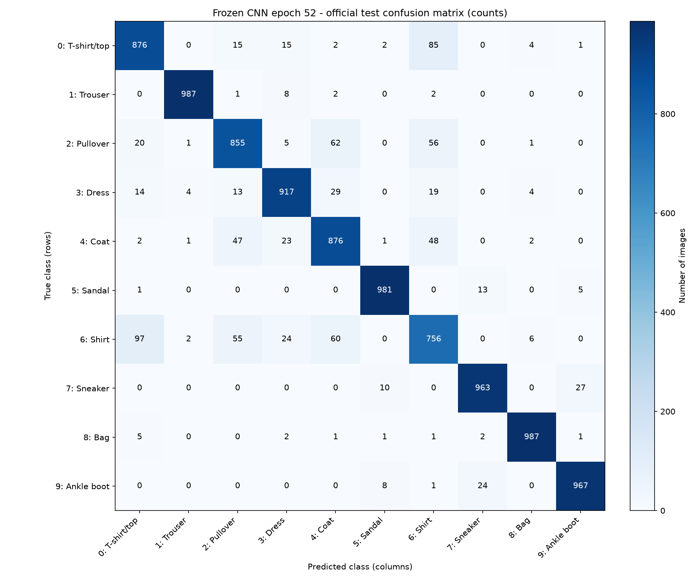
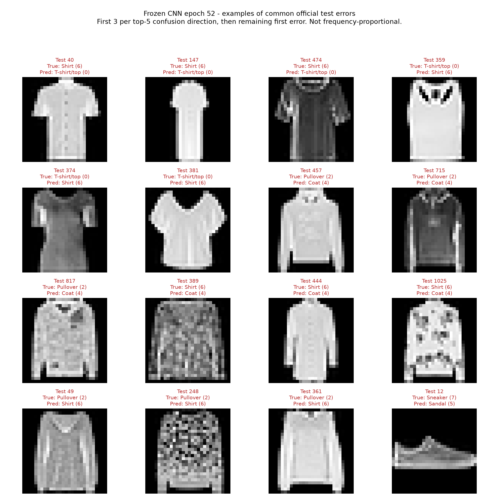
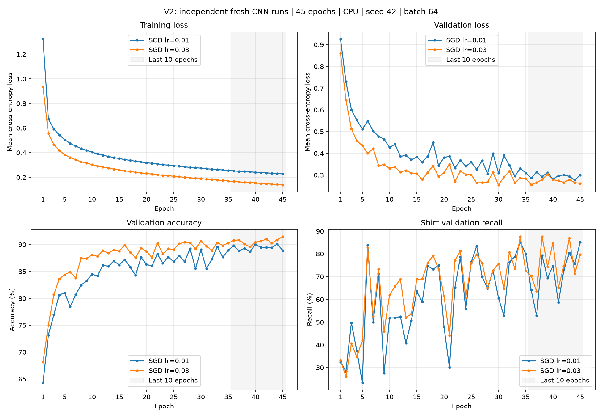
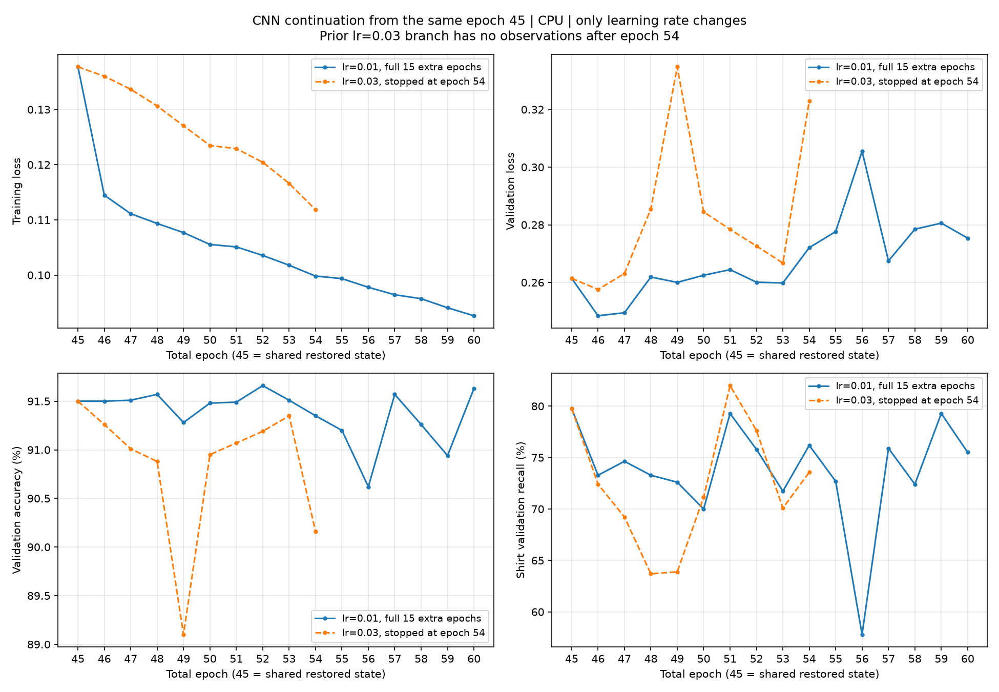

# FashionMNIST服装图像分类

这是一个面向Python初学者的 **FashionMNIST灰度服装分类基础项目**：从数据准备、前向计算、单批次更新开始，比较MLP和小型CNN，记录训练曲线、验证错误，并固定一个模型做最终官方测试。

最终CNN第52轮：**测试准确率91.65%，平均交叉熵0.271073，Shirt召回率75.60%**。测试10,000张，正确9,165、错误835；真实Shirt被预测为Pullover共55张。此次收尾沿用既有测试记录，没有再次评估测试集。

原学习计划中的网页和二维虚拟分拣尚未实现；本仓库交付范围是分类模型、实验记录和命令行样本预测。

## 从干净环境运行

解压项目ZIP后进入 `fashion-mnist-image-classifier`；或在仓库发布后克隆它再进入同名目录。推荐Python3.11，实际验证环境是macOS、Python3.11.13和CPU。

```bash
conda env create -f environment.yml
conda activate ai-classifier
python src/predict.py --index 0 --count 9
```

也可以在已有Python3.11的干净虚拟环境中安装：

```bash
python3.11 -m venv .venv
source .venv/bin/activate
python -m pip install -r requirements.txt
python src/predict.py --index 0 --count 9
```

安装命令供使用者执行，本次整理没有安装或升级依赖。依赖固定为torch2.2.2、torchvision0.17.2、NumPy1.26.4、Matplotlib3.11.2、Pillow12.3.0；其他系统和硬件尚未验证。

首次样本预测会从FashionMNIST作者的HTTPS地址自动下载官方**训练数据**至 `data/`，按原seed=42划分后取训练样本；这些样本只演示推理，不是新的独立评估。图片保存到 `outputs/final_prediction.png`。

Mac查看：

```bash
open outputs/final_prediction.png
```

也可以预测一张已有的28×28图片，此方式无需数据集：

```bash
python src/predict.py --image sample.png --output outputs/custom_prediction.png
```

自定义图片会转为灰度，仅做ToTensor，不自动缩放；必须已是28×28，最好具有FashionMNIST相似的背景和物品布局。手机服装照片不属于已验证适用范围。

## 最终模型

`final_model/model.pt`是固定第52轮的state_dict，**426,764字节，约417KiB**，直接随Git仓库和ZIP提供，无需下载额外权重或使用Git LFS。完整配置、类别名称、来源和验证/测试指标分别见该目录的JSON文件。

来源：`outputs/experiments/v2_resume45_lr001_15epochs/best_cnn.pt`，逐项参数匹配 `checkpoint_epoch_52.pt`。原始完整检查点保留在工作目录，公开包不包含它。

权重SHA-256：

```text
c972ca96c5d63c81998a6d884f57ebc42406f04a02c5368bdf1d01178d19a570
```

```bash
cd final_model
shasum -a 256 -c SHA256SUMS
cd ..
```

最终选中前45轮使用SGD学习率0.03，第46—52轮使用0.01，共40,664次参数更新。续训实验完整运行到60轮，但发布参数来自第52轮。选择标准是验证准确率最高，平分取**同一轮**较低验证损失；官方测试结果未参与选择。复制前后权重哈希一致。

## 模型与数据

MLP：Flatten → Linear(784,128) → ReLU → Linear(128,10)，101,770参数。

最终CNN：

```text
[B, 1, 28, 28]
Conv2d(1,16,3,padding=1) → ReLU → MaxPool2d(2)
Conv2d(16,32,3,padding=1) → ReLU → MaxPool2d(2)
Flatten → Linear(32*7*7,64) → ReLU → Linear(64,10)
[B, 10] raw logits
```

CNN共有105,866参数。训练时原始logits直接交给CrossEntropyLoss，不提前Softmax；SGD无动量、无权重衰减。CPU6线程，batch_size=64、num_workers=0；没有数据增强或学习率调度器。

图片仅使用ToTensor：float32、形状 `[1,28,28]`、像素范围 `[0,1]`。官方60,000张 `train=True` 图片按种子42划为50,000训练和10,000验证，无索引重叠；训练批次打乱，验证固定顺序。官方 `train=False` 的10,000张用于固定模型的最终评估。

依据现有代码与记录，测试集此前仅在准备时被加载、核对数量和类别名称，没有参与训练、调参或模型选择；证据见 `outputs/final_evaluation/data_audit.json`。这项审计不能证明未记录的外部操作。

## 实验过程和结果

先比较同为5轮的MLP/CNN，再单独研究CNN训练轮数与学习率；V2比较两组45轮，从0.03的第45轮完整状态分别继续0.03和降到0.01。续训恢复模型、优化器和可用随机/DataLoader状态；完整记录保留在训练历史中。

下表每行的准确率、损失和Shirt召回率均来自该行**同一个最佳检查点**。耗时取实际完整实验记录，续训行包含来源前45轮，不是最佳权重自身的独立训练耗时。

| 实验 | 最佳轮次 | 验证准确率 | 验证损失 | Shirt召回率 | 总实验耗时（秒） |
| --- | ---: | ---: | ---: | ---: | ---: |
| MLP · 0.01 · 5轮 | 5 | 82.13% | 0.525075 | 51.21% | 27.90 |
| CNN · 0.01 · 5轮 | 5 | 81.03% | 0.511530 | 23.43% | 72.08 |
| CNN · 0.01 · 15轮 | 14 | 86.95% | 0.369865 | 50.63% | 226.39 |
| CNN · 0.003 · 15轮 | 14 | 82.01% | 0.507244 | 28.85% | 258.51 |
| CNN · 0.03 · 15轮（V1） | 14 | 89.02% | 0.309779 | 53.53% | 229.46 |
| CNN · 0.01 · 45轮 | 44 | 90.10% | 0.277013 | 75.61% | 782.78 |
| CNN · 0.03 · 45轮 | 45 | 91.50% | 0.261417 | 79.77% | 776.00 |
| CNN · 第45轮后0.03 · 实际54轮 | 45 | 91.50% | 0.261417 | 79.77% | 932.29 |
| CNN · 第45轮后0.01 · 总60轮（最终） | 52 | 91.66% | 0.260076 | 75.80% | 1088.87 |

详细数值、指标来源和缺失项见 [实验结果记录](docs/EXPERIMENT_RESULTS.md) 和 `docs/experiment_results.json`。早期15轮对照的初始化/样本顺序记录限制保留于原报告；单次实验不能代表两种模型各自充分调优后的最佳能力。

同一第52轮模型的验证与测试成绩：

| 指标 | 验证集（选择依据） | 官方测试集（最终报告） |
| --- | ---: | ---: |
| 正确 / 总数 | 9,166 / 10,000 | 9,165 / 10,000 |
| 准确率 | 91.66% | 91.65% |
| 平均交叉熵 | 0.260076 | 0.271073 |
| Shirt召回率 | 75.80%（783/1033） | 75.60%（756/1000） |

完整测试precision/recall/F1、混淆矩阵及逐图预测保存在 `final_model/test_metrics.json` 和 `outputs/final_evaluation/`。835个错误、矩阵总和/对角线/各类数量已验证一致。本次只读取原报告，不重新计算测试成绩。

## 主要错误与结果图

整体每100张约分对92张，Shirt只有约76张。主要测试混淆：Shirt→T-shirt/top 97张、T-shirt/top→Shirt 85张、Pullover→Coat 62张、Shirt→Coat 60张、Pullover→Shirt 56张；另有Shirt→Pullover 55张。

混淆矩阵**行是真实类别，列是预测类别**。错误图按明确规则覆盖主要混淆，不按外观挑选，也不是按错误频率抽样。









## 代码、记录与运行入口

```text
src/                  模型、数据、教学演示、训练与分析代码
  predict.py          发布版样本推理入口
  final_model.py      校验哈希并加载固定CNN
  summarize_results.py 读取已有实验指标生成结果表
  build_release.py    允许清单导出与ZIP打包
final_model/          唯一公开模型、完整配置、来源、验证/测试指标
outputs/              保留的实验历史、配置、指标与结果图
  final_evaluation/   既有最终测试报告、逐张预测、矩阵和错误图
docs/                 实验表、学习记录和独立发布说明
PROGRESS.md           完整阶段进度
requirements.txt      已验证依赖版本
environment.yml       Python3.11.13的Conda环境说明
release_contents.json 发布文件清单与SHA-256（导出时生成）
```

只读取保存的记录，重新生成实验表：

```bash
python src/summarize_results.py
```

历史训练代码保留供学习。若使用者主动复现实验，可从头运行到新的空目录，例如：

```bash
python src/train.py --model cnn --epochs 5 --lr 0.01 --output-dir outputs/new_cnn_demo
```

这不是当前收尾阶段执行的步骤。公开包排除了旧权重、逐轮完整检查点和逐图验证预测；恢复旧训练、冻结V1及严格原始审计入口依赖这些本地归档，不能仅靠本包复原旧训练状态。发布包的推理、实验表及现有结果阅读不依赖它们。

整理前的详细README保存在 [阶段学习记录](docs/LEARNING_NOTES.md)。公开副本替换工作站绝对路径，原始实验文件不修改。

## 打包、下载与局限

项目ZIP和独立Git仓库使用允许清单导出；排除 `data/`、缓存、系统文件、密钥、虚拟环境、旧权重及逐轮检查点。`release_contents.json`记录文件哈希，最终模型已经包含在ZIP中。仓库上传后，GitHub的Code → Download ZIP也会包含最终权重。独立导出和上传操作见 [发布说明](docs/PUBLISHING.md)。

本项目只验证FashionMNIST的28×28灰度服装小图；没有多随机种子重复实验，没有真实照片、彩色图、复杂背景或实际分拣验证。验证集经历多次选择，验证成绩与测试成绩需要分开报告。上衣间的轮廓或细节相似可能是错误原因，但没有实验确认。测试报告只用于收尾，不据此继续调参；网页与二维分拣仍未实现。

数据来源：[FashionMNIST作者仓库](https://github.com/zalandoresearch/fashion-mnist)。程序下载时使用作者数据文件并核对其已有校验值，数据集不随项目打包。
